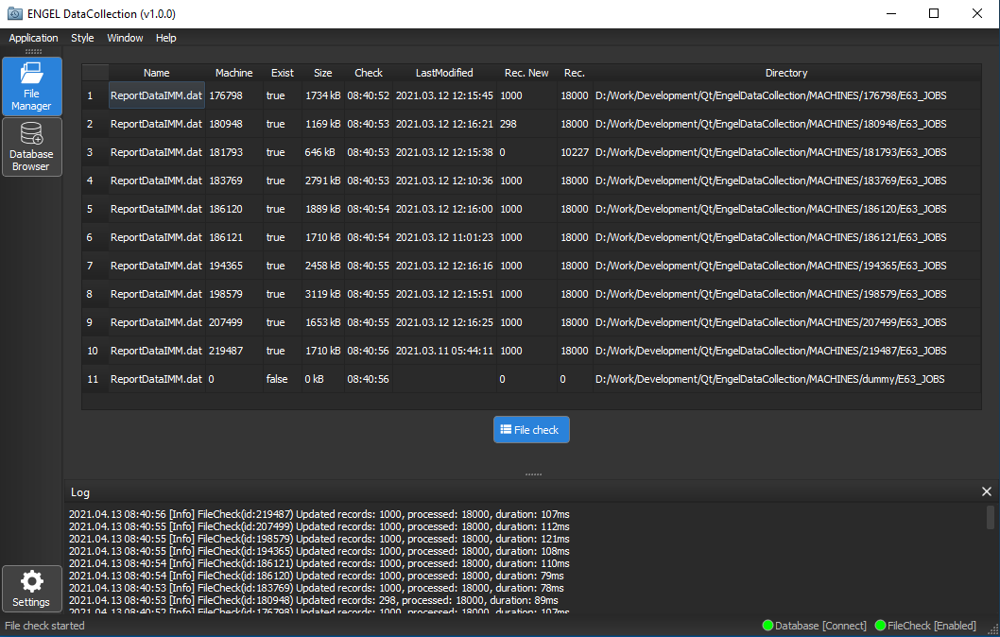
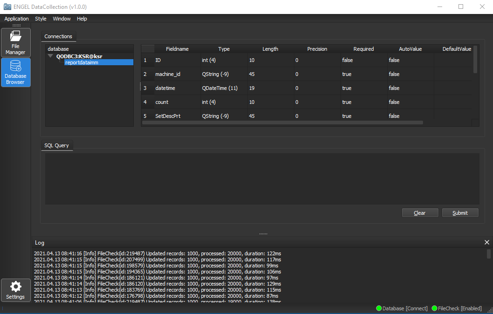
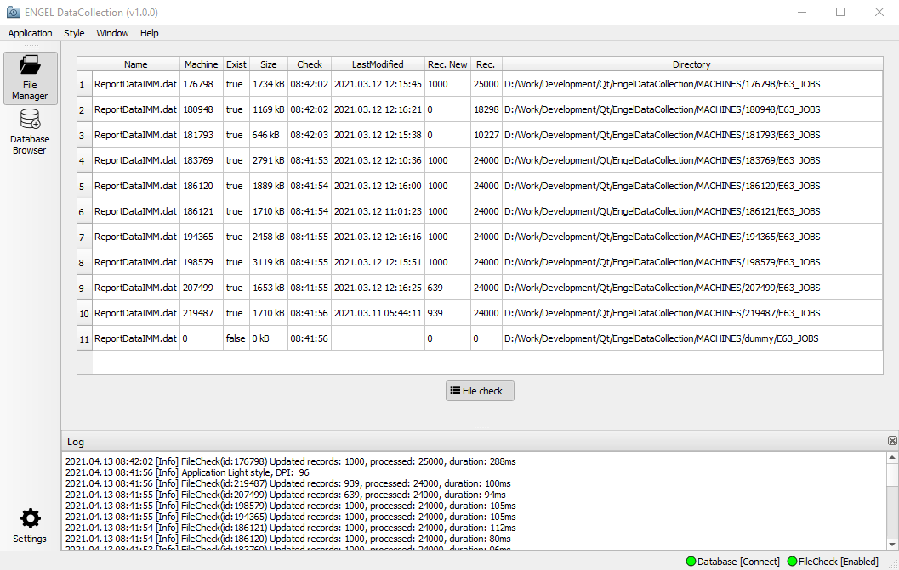

# Přehled projektu

`ENGEL Data Collection` je desktopová aplikace v C++ a Qt pro sledování reportovacích souborů strojů ENGEL a import nových výrobních záznamů do SQL databáze. Pro každý nakonfigurovaný stroj kontroluje soubor `ReportDataIMM.dat` v jeho adresáři s exporty `E63_JOBS`; nejde o přímé čtení hodnot ze stroje přes OPC UA.

Aplikace používá Qt Widgets pro uživatelské rozhraní a Qt SQL pro připojení k databázi. Zpracování souborů je rozděleno do několika částí:

- `file/FileView.*` načítá seznam strojů a nastavení kontrolovaných souborů.
- `file/FileCheckModel.*` zobrazuje stav jednotlivých souborů v tabulce.
- `file/FileCheck.*` sleduje změny souborů, načítá nové řádky reportu a ukládá je do databáze.
- `browser/` nabízí databázový prohlížeč a SQL editor.
- `settings/` spravuje konfigurační soubor a poslední importovaný čas pro každý stroj.

# Sledování reportovacích souborů

Cesty k souborům se skládají z nakonfigurovaného kořenového adresáře, ID stroje a cesty k reportu. Aplikace periodicky kontroluje, zda soubor existuje a zda se změnila jeho velikost nebo čas poslední změny. Uživatelský manuál uvádí jako příklad soubor `E63_JOBS/ReportDataIMM.dat` a konfigurovatelný interval kontroly.

Při změně se aktuální soubor zkopíruje do pomocné přípony `.check`, aby se zpracovávala stabilní kopie. První řádek se načte jako hlavička a další řádky jako data. Aplikace uchovává čas posledního importovaného záznamu pro každý stroj, takže při další kontrole může navázat na dosavadní import. Nové záznamy zpracovává po dávkách.

# Záznamy v SQL databázi

Report obsahuje pole `DATE`, `TIME`, `COUNT`, `SetDescPrt`, `ActCntMld`, `SetDescMld`, `ActCntCyc`, `ActTimCyc` a `ActStsMach`. Při zápisu se dvojice data a času převede na databázové pole `datetime` a doplní se `machine_id` z konfigurace. Záznamy se vkládají do tabulky `reportdataimm`; připojení a parametry databáze se nastavují pro cílovou instalaci.

# Uživatelské rozhraní

Hlavní pohled **File Manager** zobrazuje název reportu, ID stroje, dostupnost souboru, velikost, čas kontroly, poslední změnu, počet nových a celkem zpracovaných záznamů a adresář. Tlačítkem lze kontrolu spustit nebo zastavit. Stavový řádek ukazuje připojení k databázi a stav kontroly; dolní panel zobrazuje aplikační log.

Pohled **Database Browser** nabízí seznam databázových připojení a tabulek spolu s editorem SQL dotazů. Aplikace podporuje světlý a tmavý styl.

Následující snímky pocházejí ze složky `printscreen/`:

# Konfigurace a sestavení

Nastavení se čtou z INI souboru umístěného vedle spustitelného souboru. Konfigurace zahrnuje databázový ovladač a připojení, kořenovou cestu ke strojům, ID jednotlivých strojů, cestu k reportovacímu souboru, interval kontroly a automatické spuštění. Pro cílové prostředí je nutné doplnit vlastní hodnoty; do veřejného repozitáře nepatří přihlašovací údaje.

Projektový soubor `EngelDataCollection.pro` používá Qt Core, Gui, Widgets a SQL a vyžaduje C++17. Uživatelský manuál dokumentuje sestavení s Qt 5.14.2 a MSVC 2017.

Zdrojový kód: [CodElecCz/engel-data-collection](https://github.com/CodElecCz/engel-data-collection).
