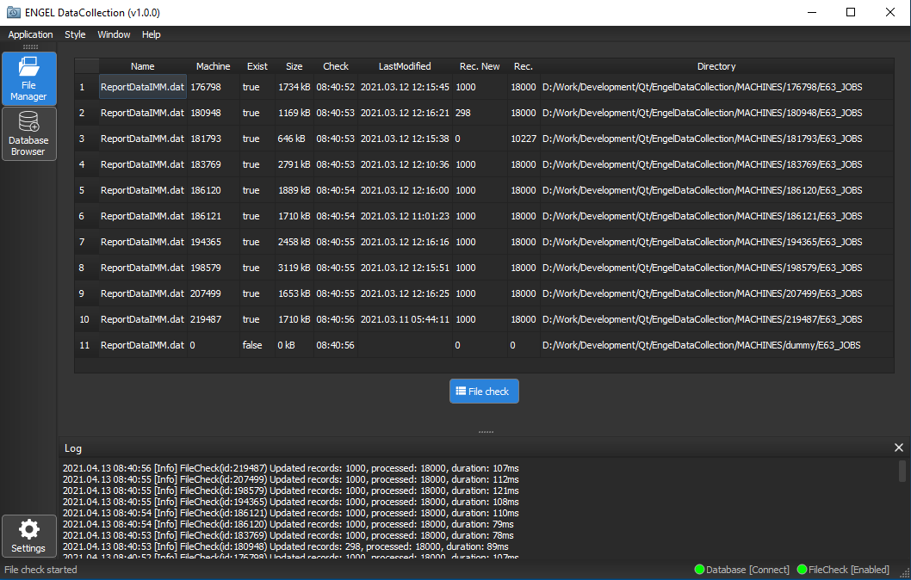
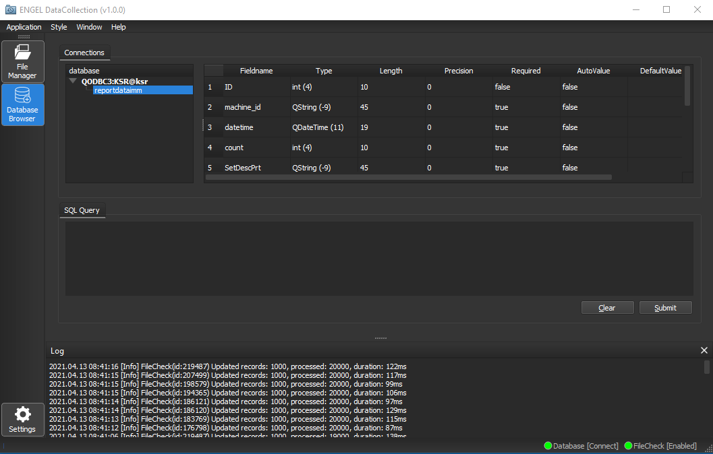
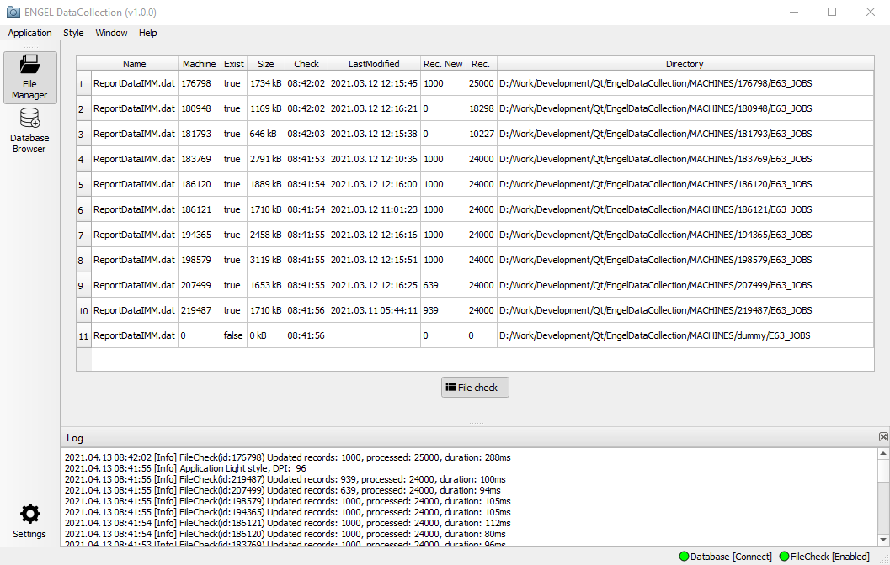

# Project overview

`ENGEL Data Collection` is a C++ and Qt desktop application for monitoring ENGEL machine report files and importing new production records into a SQL database. For each configured machine it checks a `ReportDataIMM.dat` file in the machine's `E63_JOBS` export directory; it does not read live machine values over OPC UA.

The application uses Qt Widgets for its user interface and Qt SQL for database access. File processing is split across several components:

- `file/FileView.*` loads the machine list and monitored-file settings.
- `file/FileCheckModel.*` displays the status of each file in a table.
- `file/FileCheck.*` tracks file changes, reads new report rows, and stores them in the database.
- `browser/` provides database browsing and an SQL editor.
- `settings/` manages application configuration and the last imported timestamp for each machine.

# Monitoring report files

File paths are assembled from the configured root directory, machine ID, and report path. The application periodically checks whether a file exists and whether its size or last-modified time has changed. The user manual gives `E63_JOBS/ReportDataIMM.dat` as an example report path and documents a configurable polling interval.

When a file changes, the current file is copied to a `.check` sidecar so processing uses a stable snapshot. The first line is parsed as the header and subsequent lines as data. The last imported timestamp is retained for each machine, allowing later checks to continue from the saved checkpoint. New records are processed in batches.

# SQL production records

The report contains fields such as `DATE`, `TIME`, `COUNT`, `SetDescPrt`, `ActCntMld`, `SetDescMld`, `ActCntCyc`, `ActTimCyc`, and `ActStsMach`. On insertion, the date and time are converted to the database `datetime` field and the configured `machine_id` is added. Records are inserted into the `reportdataimm` table; database connection details are configured for the target installation.

# User interface

The **File Manager** view displays the report name, machine ID, file availability, size, check time, last-modified time, new and total processed record counts, and directory. A button starts or stops checking. The status bar shows database connectivity and file-check state, while the lower panel displays the application log.

The **Database Browser** view provides a list of database connections and tables together with an SQL query editor. The application supports both dark and light styles.

The following screenshots are from the repository's `printscreen/` directory:

# Configuration and build

Settings are read from an INI file beside the executable. Configuration includes the database driver and connection, root machine directory, machine IDs, report-file path, polling interval, and whether checking starts automatically. Supply values for the target environment; do not commit deployment credentials to a public repository.

`EngelDataCollection.pro` uses Qt Core, Gui, Widgets, and SQL and requires C++17. The user manual documents a Qt 5.14.2 / MSVC 2017 build environment.

Source code: [CodElecCz/engel-data-collection](https://github.com/CodElecCz/engel-data-collection).
